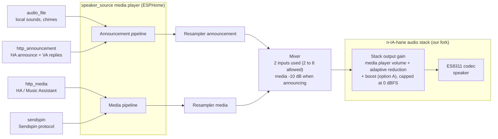

# Audio stack: forks, copies and the boost design

As of 2026-11-19.

## Overview

In production, one ESPHome core component is patched: a voice_assistant copy with
the wake-word pre-roll, meant to go upstream. The audio stack is the n-IA-hane
add-on, and our copy of it differs by one build-config commit. The micro_wake_word
copy, the voice_assistant stream selection and the stack's BSS additions are on
test branches only.

| Layer | Source | What it provides | Our changes in production |
|---|---|---|---|
| ESPHome 2026.10.2 | esphome/esphome (upstream) | Media player (speaker_source), mixer, resamplers, micro_wake_word, voice_assistant | voice_assistant copy with the wake-word pre-roll (temporary) |
| Audio stack v2026.11.0 | n-IA-hane/esphome-audio-stack | esp_audio_stack, esp_afe, esp_aec, esp_audio_capture: codec, TDM I2S, AFE/AEC, mic gain, master volume | Third party, used through our fork |
| Our stack fork | rgitha/esphome-audio-stack, branch `rgitha-v2026.11.0`, commit 487db8f | v2026.11.0 + 1 commit | GMF AI Audio 1.1.2 from Espressif's registry (`esp_afe/__init__.py`) |
| adaptive_volume | rgitha/esphome-adaptive-volume v0.4.3, dd7a8f7 | Adaptive volume reduction | Our own component |

n-IA-hane's stack is not a fork of ESPHome. It is a standalone external-components
repo: its history starts at a3799b1 "Initial ESPHome audio stack release"
(3 Jul 2026), with 118 commits to v2026.11.0 (115 by n-IA-hane, 1 each by Ben,
Juan Marcos Torero and jharris4). Its components are new, not modified copies of
ESPHome components.

## Why we switched from stock ESPHome audio

For barge-in ("stop" and the wake word during playback) and two-mic enhancement.
Recorded in the header of the first dual-mic build, `esphome-va-1-afe.yaml`
(23 Oct 2026, in this repo's first commit b7e5017).

| Need | Stock ESPHome on this board | n-IA-hane stack |
|---|---|---|
| Echo cancellation | None. i2s_audio has no speaker reference, so the mics hear replies and music | 48 kHz 4-slot TDM with the speaker reference on slot 1, fed to Espressif's AFE (AEC) |
| Both mics | One mic channel | Slots 0 (right) and 2 (left) into AFE BSS, one clean 16 kHz output |
| Board-tested settings | None | Slot map verified by the intercom author; high_perf, AGC off; type `sr` instead of `fd` (`fd` lowered STT accuracy) |

- Replaced: i2s_audio, the es7210/es8311 components, the I2S mic and speaker platforms.
- Unchanged ESPHome core: mixer, resamplers, media player, micro_wake_word, voice_assistant.
- The stock single-mic build was kept for comparison until it was retired on
  12 Nov 2026 (eb64c63).
- Voice PE gets echo cancellation from its XMOS chip in hardware; this board has no
  such chip.

## Forks and copies

Two are in production: the stack fork (a backup with a build-config change) and the
voice_assistant pre-roll patch. The rest are test-only.

| Fork or copy | Where | Branch / commit | Changes | Reason | Used in |
|---|---|---|---|---|---|
| Audio stack fork | rgitha/esphome-audio-stack | `rgitha-v2026.11.0` / 487db8f | Takes GMF AI Audio 1.1.2 from Espressif's component registry instead of the n-IA-hane/esp-gmf fork (GMF 1.1.2 needs ESP-SR 2.6.*; AFE manager API unchanged) | A copy we control in case upstream moves, rewrites or quarantines tags; Espressif's published GMF rather than a personal fork | Production |
| Audio stack fork | rgitha/esphome-audio-stack | `bss-probe` / 00598fe | esp_afe diagnostic result tap (raw_data, trigger_channel_id) | See the BSS streams; upstream has no access | BSS probe build |
| Audio stack fork | rgitha/esphome-audio-stack | `dual-mww` / cba4fbc | Result tap with up to 4 listeners; esp_afe microphone platform for raw 0 and raw 1 (applies mic gain) | Wake word on the separated streams | Test build |
| micro_wake_word copy | this repo, `components/` | `dual-mww` | Several instances (MULTI_CONF); `task_core` pinning; ring buffer option (default 120 ms, set 500 ms); one inference lock across instances (esp-nn crash); per-model peak and veto diagnostics; `on_vad_blocked` trigger | Upstream allows one instance | Test build |
| voice_assistant copy | this repo, `components/` | `dual-mww` | STT stream selection (stream whose wake word fired, with its pre-roll; fallback to the output) | Send the cleaner stream to STT | Test build |
| voice_assistant copy | this repo, `components/` | `main` | Wake-word pre-roll (150 ms) | A command said straight after the wake word lost its first syllable | Production (temporary; to go upstream, then remove) |

The copied voice_assistant and micro_wake_word C++ files stay GPLv3 (copied from
ESPHome); the rest of this repo is MIT.

## Playback architecture

The media player has two hard-coded pipelines, so the four sources share two mixer
inputs, and all volume is applied once after the mixer.

| Question | Answer |
|---|---|
| Who implements the media player? | ESPHome core (speaker_source); the two pipelines are an enum, `MEDIA_PIPELINE` and `ANNOUNCEMENT_PIPELINE` |
| Why two? | HA's model: a play command carries one `announce` flag, true or false. VA replies arrive as announcements |
| Mixer inputs | The ESPHome mixer takes 2 to 8 source speakers; per-input control is attenuation only (ducking) |
| HA volume per channel? | No. One `volume_level` (0 to 1) and mute per media player entity; separate volumes need separate entities or HA numbers |
| Own input for VA replies | Possible via voice_assistant `speaker:` instead of `media_player:`, but the media player then no longer sees replies (ducking, state, continued conversation) |
| Own input for Sendspin | Needs a second media player instance (a second HA entity) |
| More pipelines | Needs a fork of speaker_source (enum, pipeline array, routing, ducking); not taken |

## Boost design: option A (proposed, not built)

The boost goes into the output gain stage of our stack fork, after the mixer, with
the total capped at 0 dBFS. No ESPHome core changes.

**total gain = min(0 dB, media player volume + adaptive reduction + boost)**

- Media player volume = the volume slider on the device's media player entity in HA
  (also set by Music Assistant and voice commands), mapped through
  `media_volume_min`. It is not the Adaptive volume trim slider, which only feeds the
  adaptive reduction term.
- Adaptive reduction ≤ 0 dB, from adaptive_volume when Adaptive volume reduction is on.

| What is playing | Boost |
|---|---|
| VA reply | 0 dB (the reference: the slider sets reply loudness) |
| Announcement | `announcement_boost_db`, HA number −6 to +6 dB in 3 dB steps, default +6 |
| Music | `music_boost_db`, same range, default +6 |
| Urgent announcement | `urgent_boost_db`, set by the `urgent_announcement` action for the next announcement only |
| Announcement over music | Announcement boost (music is ducked 10 dB anyway) |

The clamp with +6 dB announcement boost:

| Media player volume | Reply | Announcement | Effective boost |
|---|---|---|---|
| −20 dB | −20 dB | −14 dB | +6 dB |
| −6 dB | −6 dB | 0 dB | +6 dB |
| −3 dB | −3 dB | 0 dB | +3 dB |
| 0 dB | 0 dB | 0 dB | 0 dB |

A negative boost always applies in full. With adaptive reduction it adds in the same
sum: volume −3, adaptive −6, boost +6 gives −3 dB.

Changes needed:

- Stack fork: `set_boost_db()` and the capped sum in the gain stage; a short ramp if
  gain changes there are not already smoothed (to check).
- adaptive_volume v0.4.4: remove the boost/offset logic instead of renaming it to
  `set_boost()`; it does reduction and trim only.
- YAML on main: choose the boost from the media player's announcement/media state and
  call the stack; HA numbers for the boosts; the agreed renames, loudness constant
  29 dB, mic gain max 15 dB, pilot level as a percentage.

Limits:

- One boost at a time after the mixer, so two simultaneous streams cannot get
  different gains (ducking makes this rare).
- Near full volume the boost shrinks toward 0 dB, by design.
- The boost follows the media player state; the first milliseconds of an announcement
  may play at the old gain. To check on the device.

Alternatives set aside: per-input mixer volumes need a fork of ESPHome's
speaker_source (its two pipelines are a hard-coded enum) and the mixer only
attenuates per input; a separate VA reply speaker breaks the media player's view of
replies.

## Maintenance implications

Option A would turn the stack fork from a backup into a real fork, with one
functional commit to rebase on each upstream update.

| Item | Rebase effort on update | Risk |
|---|---|---|
| Stack fork, GMF registry commit | One file (`esp_afe/__init__.py`) | Low |
| Stack fork, boost (option A) | Small change in the output gain stage | Medium: upstream dev has recent "logical master volume" commits in that area (679437a, c1db169) |
| voice_assistant pre-roll copy | Re-copy on each ESPHome update until upstream | Medium; goes away once upstream |
| Test branches (`dual-mww`, `bss-probe`) | Only if promoted to production | None until then |
| ESPHome core forks for 4 mixer inputs | Not taken | Would be high: speaker_source routing and ducking assume two pipelines |
